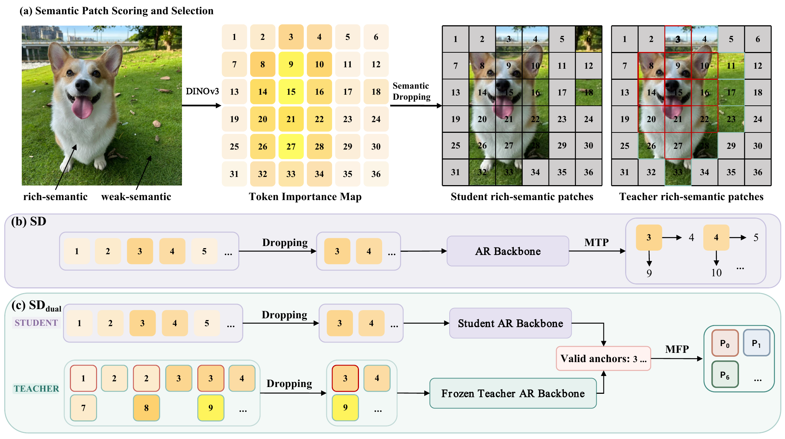

<h1 align="center">MTAR++: Multi-Token Foresight Supervision<br>for Efficient Autoregressive Image Generation</h1>

<p align="center">
  Xiongfei Yao · Guo Niu · Teng Wang · Nannan Zhu<br>
  <sub>Foshan University · The University of Hong Kong · Sun Yat-sen University</sub>
</p>

<p align="center">
  <a href="https://arxiv.org/abs/2608.25386">Conference Paper</a> ·
  <a href="docs/TRAINING.md">Usage Guide</a>
  <br><sub>The paper link refers to the preliminary MTAR work; this repository also implements the MTAR++ extension.</sub>
</p>

## 🔎 Introduction

**MTAR++** improves autoregressive image generation through spatial foresight supervision and pretrained generative knowledge transfer. Built on MTAR, it enriches training supervision while keeping the original autoregressive inference procedure unchanged.

- **Foresight supervision:** predict spatially related future tokens and features.
- **Generative knowledge transfer:** reuse representations from an existing pretrained and frozen teacher.
- **Efficient training:** reduce redundant computation through dual-path semantic dropping, without additional inference overhead.

<p align="center">
  
  <br><sub>MTAR++(L) samples on ImageNet 256 × 256.</sub>
</p>

## 🏆 Main Results

ImageNet 256 × 256 class-conditional generation with 300 training epochs. Parameter counts include student-side training auxiliaries for MTAR and MTAR++, excluding the frozen teacher and tokenizer.

| Model | Training parameters | FID ↓ | IS ↑ |
|:--|--:|--:|--:|
| LlamaGen-B | 111M | 5.46 | 193.61 |
| MTAR(B) | 138M | 4.50 | 213.96 |
| MTAR++(B) | 124M | 4.22 | 230.27 |
| LlamaGen-L | 343M | 3.80 | 248.28 |
| MTAR(L) | 387M | 2.85 | 271.41 |
| MTAR++(L) | 358M | 3.09 | 267.18 |

MTAR achieves up to 1.39× training-time speedup at the same 300-epoch budget. With both models trained for 50 epochs, MTAR++(B) using 300k student images reaches FID 6.53, compared with 7.29 for LlamaGen-B using 1.281M images. The generative teacher is pretrained on the full ImageNet training set.

[Detailed results and ablations →](docs/RESULTS.md)

## 🛠️ Method

MTP predicts future codebook indices; MFP transfers a frozen generative teacher's current- and future-position features. Both retain next-token supervision and incorporate token-level contrastive regularization.

<p align="center">
  
  <br><sub>(a) Multi-token prediction in MTAR. (b) Multi-feature prediction in MTAR++.</sub>
</p>

Semantic dropping reduces redundant token computation. Its dual-path extension compresses student and teacher sequences while preserving complete teacher targets at shared supervision anchors.

<p align="center">
  
  <br><sub>(a) Semantic scoring and selection. (b) SD. (c) Dual-path SD. The illustration uses a toy grid width of 6.</sub>
</p>

## 📜 Citation

For the extended work:

```bibtex
@unpublished{yao2026mtarpp,
  title  = {MTAR++: Multi-Token Foresight Supervision for Efficient Autoregressive Image Generation},
  author = {Yao, Xiongfei and Niu, Guo and Wang, Teng and Zhu, Nannan},
  note   = {Manuscript},
  year   = {2026}
}
```

For the preliminary MTAR work:

```bibtex
@article{niu2026mtar,
  title         = {Efficient Training with Foresight: Multi-Token Auxiliary Supervision for Autoregressive Image Generation},
  author        = {Niu, Guo and Yao, Xiongfei and Wang, Teng and Zhu, Nannan},
  journal       = {arXiv preprint arXiv:2608.25386},
  year          = {2026},
  eprint        = {2608.25386},
  archivePrefix = {arXiv},
  primaryClass  = {cs.CV},
  doi           = {10.48550/arXiv.2608.25386}
}
```

## Acknowledgements

This repository is built on [LlamaGen](https://github.com/FoundationVision/LlamaGen). We thank the authors of LlamaGen, NAR, and DINOv3 for their code and pretrained models. See [LICENSE](LICENSE) and the [licenses](licenses) directory for licensing information.
