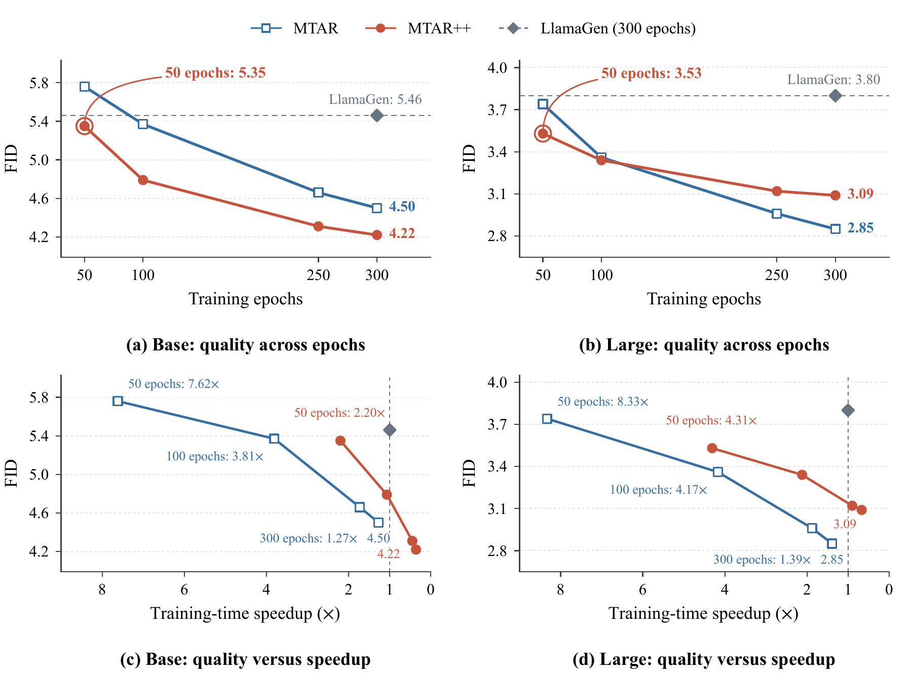
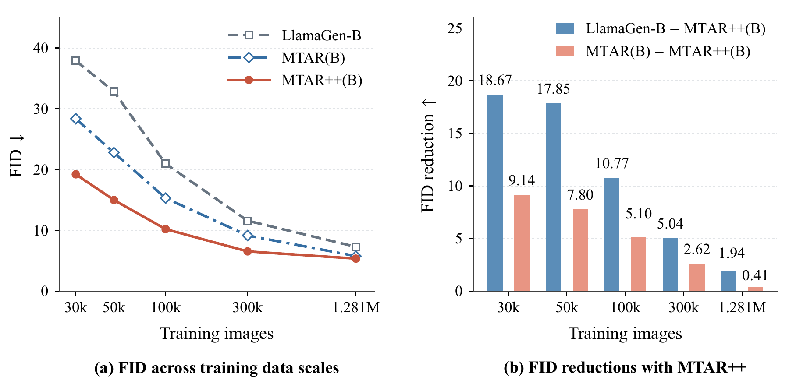
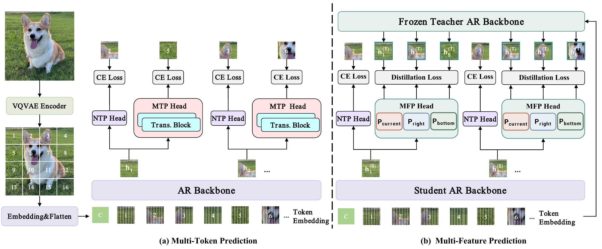

<h1 align="center">MTAR++: Multi-Token Foresight Supervision<br>for Efficient Autoregressive Image Generation</h1>

<p align="center">
  Xiongfei Yao · Guo Niu · Teng Wang · Nannan Zhu<br>
  <sub>Foshan University · The University of Hong Kong · Sun Yat-sen University</sub>
</p>

<p align="center">
  <a href="https://arxiv.org/abs/2608.25386">Conference Paper</a> ·
  <a href="docs/TRAINING.md">Usage Guide</a>
  <br><sub>The paper link refers to the preliminary MTAR work; this repository also implements the MTAR++ extension.</sub>
</p>

## 🔎 Introduction

**MTAR++** improves autoregressive image generation through spatial foresight supervision and pretrained generative knowledge transfer. Built on MTAR, it enriches training supervision while keeping the original autoregressive inference procedure unchanged.

- **Foresight supervision:** predict spatially related future tokens and features.
- **Generative knowledge transfer:** reuse representations from an existing pretrained and frozen teacher.
- **Efficient training:** reduce redundant computation through dual-path semantic dropping, without additional inference overhead.

<p align="center">
  
  <br><sub>MTAR++(L) samples on ImageNet 256 × 256.</sub>
</p>

## 🏆 Main Results

ImageNet 256 × 256 class-conditional generation with 300 training epochs. Parameter counts include student-side training auxiliaries for MTAR and MTAR++, excluding the frozen teacher and tokenizer.

<div align="center">
<table align="center">
  <thead>
    <tr><th align="left">Model</th><th align="center">Training parameters</th><th align="center">FID ↓</th><th align="center">IS ↑</th><th align="center">Precision ↑</th><th align="center">Recall ↑</th></tr>
  </thead>
  <tbody>
    <tr><td align="left">LlamaGen-B</td><td align="center">111M</td><td align="center">5.46</td><td align="center">193.61</td><td align="center">0.84</td><td align="center">0.46</td></tr>
    <tr><td align="left">MTAR(B)</td><td align="center">138M</td><td align="center">4.50</td><td align="center">213.96</td><td align="center">0.84</td><td align="center">0.48</td></tr>
    <tr><td align="left">MTAR++(B)</td><td align="center">124M</td><td align="center">4.22</td><td align="center">230.27</td><td align="center">0.83</td><td align="center">0.48</td></tr>
    <tr><td align="left">LlamaGen-L</td><td align="center">343M</td><td align="center">3.80</td><td align="center">248.28</td><td align="center">0.83</td><td align="center">0.52</td></tr>
    <tr><td align="left">MTAR(L)</td><td align="center">387M</td><td align="center">2.85</td><td align="center">271.41</td><td align="center">0.83</td><td align="center">0.54</td></tr>
    <tr><td align="left">MTAR++(L)</td><td align="center">358M</td><td align="center">3.09</td><td align="center">267.18</td><td align="center">0.83</td><td align="center">0.53</td></tr>
  </tbody>
</table>
</div>

### Training efficiency

MTAR achieves up to 1.39× training-time speedup at the same 300-epoch budget. After 50 epochs, MTAR++(B) and MTAR++(L) achieve FIDs of 5.35 and 3.53, respectively, surpassing their corresponding 300-epoch LlamaGen baselines.

<p align="center">
  
  <br><sub>Figure 6. Generation quality and training efficiency across training budgets.</sub>
</p>

### Data efficiency

With all models trained for 50 epochs, MTAR++(B) using 300k student images reaches FID 6.53, compared with 7.29 for LlamaGen-B using 1.281M images. The generative teacher is pretrained on the full ImageNet training set.

<p align="center">
  
  <br><sub>Figure 7. Generation quality across student training data scales; all models are trained for 50 epochs.</sub>
</p>

## 🛠️ Method

MTP predicts future codebook indices; MFP transfers a frozen generative teacher's current- and future-position features. Both retain next-token supervision and incorporate token-level contrastive regularization.

<p align="center">
  
  <br><sub>(a) Multi-token prediction in MTAR. (b) Multi-feature prediction in MTAR++.</sub>
</p>

Semantic dropping reduces redundant token computation. Its dual-path extension compresses student and teacher sequences while preserving complete teacher targets at shared supervision anchors.

## 📜 Citation

For the preliminary MTAR work:

```bibtex
@article{niu2026mtar,
  title         = {Efficient Training with Foresight: Multi-Token Auxiliary Supervision for Autoregressive Image Generation},
  author        = {Niu, Guo and Yao, Xiongfei and Wang, Teng and Zhu, Nannan},
  journal       = {arXiv preprint arXiv:2608.25386},
  year          = {2026},
  eprint        = {2608.25386},
  archivePrefix = {arXiv},
  primaryClass  = {cs.CV},
  doi           = {10.48550/arXiv.2608.25386}
}
```

## Acknowledgements

This repository is built on [LlamaGen](https://github.com/FoundationVision/LlamaGen). We thank the authors of LlamaGen, NAR, and DINOv3 for their code and pretrained models. See [LICENSE](LICENSE) and the [licenses](licenses) directory for licensing information.
