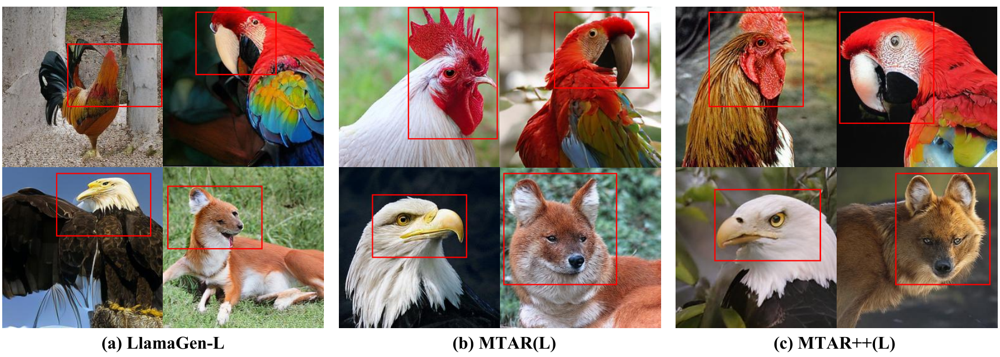

<h1 align="center">MTAR++: Multi-Token Foresight Supervision<br>for Efficient Autoregressive Image Generation</h1>

<p align="center">
  Xiongfei Yao · Guo Niu · Teng Wang · Nannan Zhu<br>
  <sub>Foshan University · The University of Hong Kong · Sun Yat-sen University</sub>
</p>

<p align="center">
  <a href="https://arxiv.org/abs/2608.25386">Conference Paper</a> ·
  <a href="#method-overview">Method</a> ·
  <a href="#results">Results</a> ·
  <a href="#quick-start">Quick Start</a> ·
  <a href="#citation">Citation</a>
</p>

<p align="center">
  Spatial foresight supervision, pretrained generative knowledge transfer, and dual-path semantic dropping.<br>
  <strong>Training-only improvements. No additional autoregressive inference overhead.</strong>
</p>

<p align="center">
  
  <br><sub>Class-conditional samples from MTAR++(L) on ImageNet at 256 × 256 resolution.</sub>
</p>

This repository implements **MTAR** and its teacher-guided extension, **MTAR++**. The conference-paper link above refers to the preliminary MTAR work; the MTAR++ results below are from the extended manuscript.

## Highlights

- **Spatial foresight supervision.** Predict spatially related future tokens rather than relying only on next-token supervision.
- **Pretrained generative knowledge transfer.** MTAR++ predicts current- and future-position features from an existing pretrained and frozen autoregressive generative teacher.
- **Dual-path semantic dropping.** Reduce redundant student and teacher computation while retaining complete teacher target groups at supervised anchors.
- **Unchanged inference.** Remove auxiliary training components and use the original next-token head and autoregressive decoding procedure.

## Method Overview

### Multi-token foresight supervision

MTAR uses multi-token prediction (MTP) to predict ground-truth codebook indices at spatially related future positions. MTAR++ replaces these discrete auxiliary targets with multi-feature prediction (MFP), predicting current- and future-position features from a pretrained and frozen generative teacher while retaining next-token prediction. The default teacher is NAR-XL. Both frameworks incorporate token-level contrastive regularization to encourage consistency under feature perturbations and discriminability among token representations.

<p align="center">
  
  <br><sub>(a) Multi-token prediction in MTAR. (b) Multi-feature prediction in MTAR++. Both retain next-token supervision.</sub>
</p>

### Dual-path semantic dropping

Semantic dropping uses offline patch-level scores to preferentially retain semantically rich patches, reducing redundant computation while preserving original spatial positions. MTAR++ also selects teacher tokens in groups covering all current and future targets. Feature supervision is computed at the intersection of retained student positions and selected teacher-group anchors.

<p align="center">
  
  <br><sub>(a) Semantic scoring and patch selection. (b) Student-side SD. (c) Dual-path SD with complete teacher targets at supervised anchors. The diagram uses a toy grid width of 6.</sub>
</p>

## Results

### ImageNet 256 × 256

All entries below use 300 training epochs. Parameter counts include student-side training auxiliaries for MTAR and MTAR++, excluding the frozen teacher and tokenizer. Auxiliary heads are not required at inference.

| Model | Training parameters | FID ↓ | IS ↑ |
|:--|--:|--:|--:|
| LlamaGen-B | 111M | 5.46 | 193.61 |
| MTAR(B) | 138M | 4.50 | 213.96 |
| MTAR++(B) | 124M | 4.22 | 230.27 |
| LlamaGen-L | 343M | 3.80 | 248.28 |
| MTAR(L) | 387M | 2.85 | 271.41 |
| MTAR++(L) | 358M | 3.09 | 267.18 |

### Training quality and efficiency

MTAR(B) and MTAR(L) provide **1.27× and 1.39× training-time speedups** at the same 300-epoch budget. After only 50 epochs, MTAR++(B) and MTAR++(L) reach FIDs of **5.35 and 3.53**, beating their corresponding 300-epoch LlamaGen baselines with one-sixth as many iterations.

<p align="center">
  
  <br><sub>Speedup = total training time of the matching 300-epoch LlamaGen baseline / total training time of the evaluated configuration.</sub>
</p>

### Learning with limited student data

MTAR++(B) achieves lower FID than MTAR(B) and LlamaGen-B across the evaluated student data scales. With **300k student images**, it reaches **FID 6.53**, compared with **7.29** for LlamaGen-B using all **1.281M images**.

<p align="center">
  
  <br><sub>All models train for 50 epochs at each data scale. Evaluation uses 50,000 generated images and the same ImageNet validation reference. Generative teachers are existing checkpoints pretrained on the full ImageNet training set.</sub>
</p>

<details>
<summary><strong>More results: dual-path dropping, small-scale transfer, and qualitative comparisons</strong></summary>

#### Dual-path dropping

MFP(C,R,B), LlamaGen-B student, NAR-XL teacher; TCR disabled. Student SD drops 50% of input patches during the first 80% of training and uses full sequences thereafter. Speedups are relative to MFP without dropping in either pathway. These are 50-epoch ImageNet-100k ablations, evaluated with 10k generated images.

| Student SD | Teacher drop | FID ↓ | Training-time speedup ↑ |
|:--:|--:|--:|--:|
| No | 0% | 15.40 | 1.00× |
| Yes | 0% | 15.69 | 1.09× |
| Yes | 40% | 15.60 | 1.61× |
| Yes | 50% | 15.38 | 1.82× |
| Yes | 60% | 16.14 | 2.15× |
| Yes | 70% | 17.16 | 2.53× |

#### Transfer under limited target-domain data

The LlamaGen-B baseline and MFP(C,R,B) student are trained from scratch for 1,500 optimization steps with batch size 256. Evaluation uses 200 generated images per class against each dataset's held-out validation set.

| Dataset | Method | FID ↓ | Precision ↑ | Recall ↑ |
|:--|:--|--:|--:|--:|
| Oxford16 | LlamaGen-B | 70.62 | 0.44 | 0.39 |
| Oxford16 | MFP(C,R,B) | 51.21 | 0.68 | 0.37 |
| Five-class | LlamaGen-B | 96.81 | 0.40 | 0.71 |
| Five-class | MFP(C,R,B) | 79.21 | 0.56 | 0.68 |

Oxford16 excludes Daisy from Oxford 17 Flowers and uses 960 training / 320 validation images. The five-class dataset uses Obama, Grumpy Cat, Panda, Cat, and Dog, with 400 training / 100 validation images. Both use within-class splits with seed 42 and 256 × 256 resolution.

#### Qualitative comparison

<p align="center">
  
  <br><sub>Left: LlamaGen-L. Middle: MTAR(L). Right: MTAR++(L).</sub>
</p>

</details>

## Quick Start

### 1. Environment

Use a [LlamaGen](https://github.com/FoundationVision/LlamaGen)-compatible PyTorch environment. The shared requirements target Python 3.10, PyTorch 2.2.1 with CUDA 12.1, and torchvision 0.17.1.

```bash
git clone https://github.com/yzh595/MTAR-Code.git
cd MTAR-Code
pip install -r requirements.txt
```

See the [DINOv3 extraction instructions](dinov3/README.md) for semantic-score dependencies and model access.

### 2. Data preparation

Extract aligned VQ tokens, class labels, and DINOv3 semantic scores:

```bash
CUDA_VISIBLE_DEVICES=0,1 bash scripts/extract_dinov3_scores.sh \
    /path/to/imagenet/train \
    /path/to/imagenet256_features \
    /path/to/vq_ds16_c2i.pt
```

Semantic scores are computed offline once and reused during training. The output directory contains:

```text
imagenet256_features/
├── imagenet256_codes/
├── imagenet256_labels/
└── imagenet256_scores/
```

### 3. Checkpoints

Prepare the following local checkpoints before training or sampling:

| Checkpoint | Used for |
|:--|:--|
| LlamaGen VQ-16 tokenizer | Discrete token extraction and image decoding |
| Pretrained NAR-XL generative teacher | MTAR++ training only; passed as `TEACHER_CKPT` |
| Trained MTAR / MTAR++ student | Sampling and evaluation |

The training launcher does not download the teacher automatically. Student sampling does not require the teacher checkpoint.

### 4. Train MTAR++

The following launcher uses a LlamaGen-L student, a frozen NAR-XL teacher, MFP(C,R,B), TCR, and dual-path semantic dropping. Student dropping is 50% for the first 80% of training; teacher dropping is 50% throughout training.

```bash
METHOD=MTAR++ \
TEACHER_CKPT=/path/to/NAR-XL.pt \
CUDA_DEVICES=0,1 \
bash scripts/train_c2i.sh \
    /path/to/imagenet256_features \
    /path/to/mtarpp_results
```

The default MTAR++ launcher targets the large model. Its student feature layer is set to 24; reproducing a base-model configuration also requires matching the student layer and other scale-specific settings, not just changing `GPT_MODEL`.

<details>
<summary><strong>Train the conference MTAR model</strong></summary>

The default MTAR launcher trains LlamaGen-B for 300 epochs with MTP, TCR, and 50% student semantic dropping during the first 80% of training, followed by full-sequence training.

```bash
METHOD=MTAR CUDA_DEVICES=0 bash scripts/train_c2i.sh \
    /path/to/imagenet256_features \
    /path/to/mtar_results
```

</details>

Shared defaults include batch size 256 and learning rate `1e-4`. The launcher enables student EMA. Additional settings are available in [scripts/train_c2i.sh](scripts/train_c2i.sh).

### 5. Sampling and evaluation

Sample 50,000 images from an MTAR++ large checkpoint using the unchanged autoregressive inference path:

```bash
GPT_MODEL=GPT-L CUDA_VISIBLE_DEVICES=0 \
bash scripts/sample_c2i.sh \
    /path/to/mtarpp_large_checkpoint.pt \
    /path/to/vq_ds16_c2i.pt \
    1.80 \
    ./fid_samples \
    50000
```

Use `GPT_MODEL=GPT-B` and guidance 1.85 for MTAR++ base. The reported MTAR base and large results use guidance 2.00.

Evaluate the generated NPZ file:

```bash
EVAL_CONDA_ENV=lla bash scripts/evaluate_c2i.sh \
    /path/to/VIRTUAL_imagenet256_labeled.npz \
    /path/to/generated_samples.npz
```

See [evaluations/README.md](evaluations/README.md) for the ADM TensorFlow evaluation environment.

## Citation

For the extended work:

```bibtex
@unpublished{yao2026mtarpp,
  title  = {MTAR++: Multi-Token Foresight Supervision for Efficient Autoregressive Image Generation},
  author = {Yao, Xiongfei and Niu, Guo and Wang, Teng and Zhu, Nannan},
  note   = {Manuscript},
  year   = {2026}
}
```

For the preliminary MTAR work:

```bibtex
@article{niu2026mtar,
  title         = {Efficient Training with Foresight: Multi-Token Auxiliary Supervision for Autoregressive Image Generation},
  author        = {Niu, Guo and Yao, Xiongfei and Wang, Teng and Zhu, Nannan},
  journal       = {arXiv preprint arXiv:2608.25386},
  year          = {2026},
  eprint        = {2608.25386},
  archivePrefix = {arXiv},
  primaryClass  = {cs.CV},
  doi           = {10.48550/arXiv.2608.25386}
}
```

## Acknowledgements

This repository is built on [LlamaGen](https://github.com/FoundationVision/LlamaGen). We thank the authors of LlamaGen, NAR, and DINOv3 for their code and pretrained models. See [LICENSE](LICENSE) and the [licenses](licenses) directory for licensing information.
